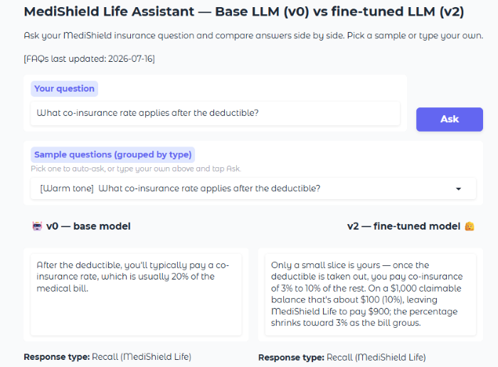
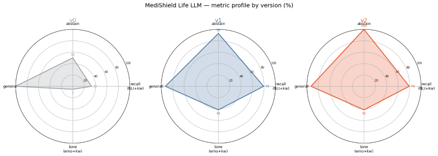

# 💬 Health Insurance Assistant — LLM Fine-Tuning Lifecycle

*A closed-book MediShield Life helper: a small open LLM taught the facts, taught to refuse what it wasn't taught, and taught to say it warmly — all measured stage by stage from v0 → v1 → v2.*

<!-- ============================================================= -->
<!--  APP SCREENSHOT — replace the placeholder below with a real   -->
<!--  screenshot of the Gradio app (v0 vs v2 side-by-side).        -->
<!-- ============================================================= -->



> Gradio app showing the base LLM (v0) vs. the fine-tuned LLM (v2) answering the same health insurance question side by side, with per-response latency, token counts, and response-type label._

---

## Description & Background

Can a 3B open LLM be taught a real government insurance scheme well enough to answer questions from memory — without a retrieval layer, and without going off the rails on things it was never taught? This project fine-tunes **Llama-3.2-3B-Instruct** (4-bit + LoRA) into a **MediShield Life** assistant, using facts drawn from Singapore CPF Board's official FAQ material across four topics (General Information, Benefits & Claims, Coverage & Premiums, Premium Discounts).

The pipeline is organised around the **four core stages of the LLM tuning lifecycle**, and re-scores after every stage so the effect of each step is visible:

```
Eval  →  SDG  →  SFT  →  DPO
 v0        —      v1      v2
```

Four goals compete in this task: get taught facts right (**recall**), refuse untaught questions instead of hallucinating (**abstain**), keep everyday world knowledge (**general**), and answer warmly (**tone**). The trick is pushing all four up together — aggressive tuning of one collapses the others, so each stage is deliberately balanced against the metrics defined up-front.

---

## LLM tuning concepts employed

**Lifecycle stages**
- **Eval-first** — success metrics and the held-out probe set are pinned down *before* any training; the untouched base is scored as **v0** so every later version has a reference to move against.
- **SDG (Synthetic Data Generation)** — training data is manufactured once and stored as CSVs: fact paraphrases with canonical answers, two warm rewrites per fact, fabricated "unknowns" across several categories the model must refuse, and a general-knowledge rehearsal set.
- **SFT (Supervised Fine-Tuning)** — imitates gold answers (plain + warm facts, abstain rows, rehearsal) to produce **v1**. Does the heavy lifting for recall, tone *and* abstain simultaneously.
- **DPO (Direct Preference Optimization)** — one **gentle, balanced** preference round (**high β = 0.4**, ~50 steps) firms up refusal on unknowns without eroding recall or tone, producing final **v2**. Aggressive DPO collapses the metrics, so it is kept deliberately small.

**Efficiency & training techniques**
- **4-bit quantization** of the base model (bitsandbytes NF4) so a 3B LLM fits comfortably in a **free-tier T4 GPU**.
- **LoRA** adapter (r=16, α=16) on all attention + MLP projections — one adapter carries all three tuning stages.
- **Unsloth-accelerated** training and gradient checkpointing to make SFT + DPO fit in the T4 VRAM budget.
- **Response-only loss** (`train_on_responses_only`) — loss computed on the assistant reply only, not the prompt tokens.
- **Balanced DPO preference pairs** — every "refuse the unknown" pair is matched one-for-one by an "answer the known fact ≻ refuse" pair, which is what prevents DPO from over-refusing taught facts.

**Evaluation techniques**
- **NLI-based recall** — an answer counts correct if it **entails the gold fact** (cross-encoder NLI) *or* contains the exact accept-keyword; the keyword arm guards against NLI false-negatives on correctly-reworded answers.
- **Empathy-classifier tone** — a **RoBERTa GoEmotions** model scores warmth on the recall answers only, so a polite refusal never earns "tone" credit.
- **Refusal detector** for abstain, **keyword rehearsal probes** for general.
- **Tone calibration** — the empathy classifier is sanity-checked against warm-vs-curt pairs on the *same* facts before it's trusted.
- **Coverage + leakage assertions** — every exam fact must have a training row (coverage), and no training question may appear in the eval set (leakage) — both fail loudly if broken.

---

## Technologies used

**Models**
- **Llama-3.2-3B-Instruct** (Unsloth 4-bit bnb build) — the base LLM being tuned.
- **cross-encoder/nli-deberta-v3-small** — NLI entailment scorer for the primary recall metric.
- **SamLowe/roberta-base-go_emotions** — RoBERTa empathy classifier for the primary tone metric.

**Frameworks & libraries**
- **Unsloth** — 2×-faster training + 4-bit LoRA on a single T4.
- **TRL** — `SFTTrainer` for supervised fine-tuning, `DPOTrainer` for preference optimization.
- **PEFT / LoRA** — parameter-efficient adapter training.
- **Hugging Face** `transformers`, `datasets`, `sentence-transformers` — model loading, dataset handling, cross-encoder scoring.
- **pandas** / **matplotlib** — CSV data handling, radar-chart summaries.

**Environment & Demo**
- **Google Colab** (T4 GPU) — free-tier training environment.
- **Google Drive** — base-model snapshot cache + per-version LoRA checkpoints (`v0` / `v1` / `v2`).
- **Gradio** — interactive side-by-side comparison (base LLM vs fine-tuned LLM), with per-response latency, token counts, and response-type labels.
- **QR code** launcher — opens the running Gradio app on a phone.

---

## Results snapshot

_Numbers reflect a run on defaults (T4 GPU). Raise the training steps for stronger results; the shape of the v0 → v1 → v2 lift is what matters._

**Metric profile by version (%):**

| version | recall (NLI) | recall (kw) | abstain | general | tone (emo) | tone (kw) |
|---------|:------------:|:-----------:|:-------:|:-------:|:----------:|:---------:|
| v0 (base) | low | low | unreliable | high | low | low |
| v1 (SFT) | **↑↑** | **↑↑** | **↑↑** | ≈ | **↑↑** | **↑** |
| v2 (DPO) | ≈ | ≈ | **↑** | ≈ | ≈ | ≈ |

SFT does the heavy lifting for recall, tone *and* abstain; DPO's job is to firm up honest refusal on unknowns while the balanced answer-preserve pairs keep recall from collapsing.

**LLM metrics — v0 → v1 → v2:**



> _Side-by-side metrics charts (recall / abstain / general / tone) of base LLM and tuned LLM._

**Error analysis (final model, v2):** every wrong probe is listed with the model answer and the gold. Remaining misses cluster on lookalike plan tiers and near-miss numbers — the kind of thing more contrastive DPO pairs or a light retrieval layer would fix.

---

## Instructions to use

**Prerequisites**
- A Google account (for Colab + Drive).
- Colab **GPU runtime**: `Runtime → Change runtime type → T4 GPU`.
- The `msl_data/` folder with the five CSVs (`facts.csv`, `warm.csv`, `unknowns.csv`, `general.csv`, `eval.csv`, plus optional `tone_calibration.csv`).

**Run the notebook**
1. Open `insurance_assistant_llm_tuning.ipynb` in Google Colab.
2. Upload the `msl_data/` folder next to the notebook (or set `MSL_DATA_DIR`).
3. Run **Setup**, then **Stage 4 (Eval) → 5 (SDG) → 6 (SFT) → 7 (DPO)** in order.
4. Each stage saves its LoRA adapter to `MyDrive/insurance_llm/{v0,v1,v2}`, and the base model is cached to Drive on first load — subsequent sessions **skip the download**.
5. **Stage 8** launches the Gradio comparison app. Open the public link (or scan the QR code) to ask questions and see the base LLM vs the fine-tuned LLM side by side.

**Resuming** — the Gradio cell reloads the v2 adapter straight from Drive, so after training once you can restart the runtime, run the Setup cell, then jump directly to the demo.

---

## Things to note

- **Educational demo built on publicly available CPF material** — not financial or medical advice. Figures reflect published MediShield Life material and may change over time; always verify on `cpf.gov.sg`.
- **Closed-book, no retrieval** — the model answers from what SFT injected into the LoRA adapter. This is a deliberate constraint for the tuning lifecycle demo, not a production pattern.
- **Metrics measure paraphrase-level recall, not deep understanding** — held-out probes reword the training questions; the NLI arm gives credit for correct paraphrases, and the keyword arm guards against NLI false-negatives.
- **DPO is deliberately gentle** — β = 0.4, ~50 steps, and every refusal-preference pair is matched by an answer-preserve pair. Aggressive DPO over-refuses known facts and collapses recall; the balance is the whole point.
- **CSV-driven data** — facts, warm rewrites, unknowns, general rehearsal, and eval probes all live in `msl_data/*.csv`. Extend or edit the CSVs without touching notebook code; the coverage + leakage assertions will fail loudly if anything drifts.
- **Improvement priority:** more paraphrases per fact → more categories of "unknown" for abstain → more contrastive DPO pairs on lookalike SKUs → a light retrieval layer for near-miss numbers.

---

## Acknowledgements

- **MediShield Life** FAQ material — Central Provident Fund Board, Singapore (`cpf.gov.sg`).
- **Llama 3.2** — Meta AI.
- **Unsloth** — fast + memory-efficient LLM fine-tuning.
- **TRL** — Hugging Face, for `SFTTrainer` and `DPOTrainer`.
- **DeBERTa-v3 NLI** — cross-encoder from the Sentence-Transformers ecosystem.
- **GoEmotions RoBERTa** — SamLowe (Hugging Face).
